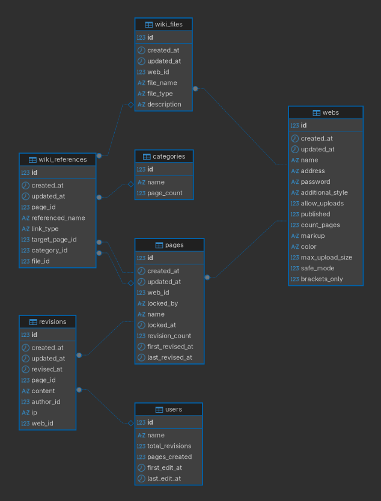

# NLab-DL — nLab MariaDB Source & Data Lake Platform

This repository provides a complete, reproducible **OLTP-to-Data-Lake** stack built around the **nLab mathematical wiki** (`nlab_db` in MariaDB 11: real wiki content + full git revision history + relational enrichment + 1,000,000-page scaling), unified with a Medallion Lakehouse (**Silo S3 + Airflow + DuckDB + Hive Metastore + Trino + Apache Superset**) calibrated to run comfortably on hosts with up to **16 GB RAM**.

---

## Repository Structure

```text
NLab-DL/
├── .env.example                          # Default MariaDB & Data Lake configuration
├── .gitignore
├── docker-compose.yml                    # Unified stack: MariaDB + Silo + HMS + Trino + Airflow + Superset
├── requirements.txt                      # Host-side Python dependencies (DB rebuild scripts)
├── docs/
│   └── er-diagram.png                    # Final 7-table enriched ER diagram
├── data/
│   └── dumps/
│       ├── .gitkeep
│       ├── dump_dev.sql.gz               # Lightweight dev dump (~29 MB, included in Git, loads in < 15s)
│       └── dump_completo.sql             # (gitignored) Optional full 1M-page MariaDB dump (~4.88 GB)
├── database/
│   ├── sql/
│   │   └── 01_schema.sql                 # Base 5-table MariaDB DDL (for rebuild from scratch)
│   └── pipeline/                         # OLTP rebuild, dump restore & 1M-page scaling scripts
└── platform/
    ├── README.md                         # Data Lake quick reference & credentials
    ├── airflow/                          # Airflow 2.10 + DuckDB (httpfs & mysql pre-installed)
    ├── dags/
    │   └── pipeline_nlab.py              # Medallion DAG: Bronze -> Prata -> Ouro -> HMS
    ├── hive/
    │   └── metastore-site.xml            # Hive Metastore config (mariadb-metastore + Silo S3A)
    ├── pipeline/
    │   ├── config.py                     # Shared MariaDB, Silo S3, DuckDB & HMS helpers
    │   ├── bronze.py                     # Chunked MariaDB -> Silo Parquet (Snappy, partitioned)
    │   ├── prata.py                      # DuckDB cleaning, LONGTEXT metrics & link resolution
    │   ├── ouro.py                       # DuckDB Star Schema (5 dims + 2 facts)
    │   ├── registrar_tabelas.py          # Hive Metastore catalog + Bronze partition registration
    │   └── run.py                        # CLI orchestrator for manual runs
    ├── sql/
    │   ├── verificar.sql                 # Trino smoke tests across bronze/prata/ouro & MariaDB
    │   └── consultas_analiticas.sql      # 11 ready-to-use Trino/Superset analytics queries
    ├── superset/                         # Superset 3.1 + sqlalchemy-trino
    └── trino/
        ├── catalog/
        │   ├── hive.properties           # Trino Hive connector -> Silo S3 + HMS
        │   └── mariadb_fonte.properties  # Federated Trino MariaDB connector -> nlab_db
        └── etc/                          # Trino JVM & memory configuration (16 GB host budget)
```

---

## Final Relational Schema (OLTP — 7 Tables)

The base DDL (`database/sql/01_schema.sql`) creates the 5 core wiki tables (`webs`, `pages`, `revisions`, `wiki_files`, `wiki_references`). Step 5 (`05_enrich_model.py`) normalizes `users` and `categories`, backfills `wiki_files.file_type`, adds denormalized page metrics, resolves polymorphic references, and enforces 8 InnoDB foreign keys:



| Table | Role |
| :--- | :--- |
| `webs` | Root wiki instance (`nLab`) |
| `pages` | Wiki pages with denormalized `revision_count`, `first_revised_at`, `last_revised_at` |
| `revisions` | Full chronological edit history (`content LONGTEXT`, `revised_at`, `author_id -> users.id`) |
| `users` | Normalized authors with `total_revisions`, `pages_created`, `first_edit_at`, `last_edit_at` |
| `categories` | Normalized page categories (`page_count`) |
| `wiki_files` | Referenced media/files (`file_name`, `file_type`, `description`) |
| `wiki_references` | Wiki link graph (`L`, `W`, `R`, `I`, `C`, `F`, `E`) with resolved nullable FKs |

---

## Data Lake Architecture (Medallion)

* **Object Storage:** **Silo (`pgsty/silo` + `pgsty/mc`)** — open-source drop-in fork of MinIO (`:9000` S3 API, `:9001` Web Console).
* **Bronze (`s3a://bronze/{tabela}/dt_ingestao=YYYY-MM-DD/`):** faithful Snappy Parquet extract from MariaDB paginated by primary-key `id` ranges (`revisions` in uniform 5k-ID chunks to bound RAM on `LONGTEXT`; `pages` in 100k; `wiki_references` in 250k) with formal Hive partitions.
* **Prata (`s3a://prata/{tabela}/`):** DuckDB out-of-core transformations (`1000MB` memory limit + spill-to-disk, tuned for 16 GB hosts / 8 GB WSL2 default). Extracts text metrics (`content_length`, `word_count`, `internal_link_count`, `fl_possui_latex`) from `revisions.content` without duplicating gigabytes of raw text, and resolves missing synthetic `target_page_id` references.
* **Ouro (`s3a://ouro/{tabela}/`):** dimensional Star Schema (`dim_tempo`, `dim_usuario`, `dim_categoria`, `dim_tipo_referencia`, `dim_pagina`, `fato_revisoes`, `fato_referencias`) served via **Trino** and **Apache Superset**.

---

## Quickstart

### 1. Configure environment

```bash
cp .env.example .env
```

### 2. Build and start the unified stack

The repository ships with a lightweight, relationally complete **`data/dumps/dump_dev.sql.gz`** (~29 MB: 4,706 pages, 17,114 revisions, 80,096 references, all 7 tables and 8 FKs) mounted by default so anyone can clone and run the full Data Lake in **under 1 minute**:

```bash
docker compose build airflow superset
docker compose up -d
```

> Want to run against the full 1M-page dataset (~4.88 GB, ~15–25 min initial import)? Place `dump_completo.sql` in `data/dumps/dump_completo.sql`, swap the init volume line in `docker-compose.yml`, and recreate the `mariadb_data` volume (`docker compose down -v && docker compose up -d`).

### 3. Run the Medallion Pipeline

* **Airflow UI (`http://localhost:8082`):** log in with `admin` / `admin`, enable and trigger **`pipeline_nlab`**.
* **CLI inside the Airflow container:**
  ```bash
  docker exec -it airflow python /opt/airflow/pipeline/run.py
  ```

### 4. Query & Visualize

* **Verify tables in Trino:**
  ```bash
  docker exec -i trino trino < platform/sql/verificar.sql
  ```
* **Silo Console:** `http://localhost:9001` (`siloadmin` / `siloadmin123`)
* **Trino Web UI:** `http://localhost:8080`
* **Apache Superset:** `http://localhost:8088` (`admin` / `admin`) → add database `trino://trino@trino:8080/hive` and run queries from `platform/sql/consultas_analiticas.sql`.

---

## OLTP Database Utilities (Optional)

If you want to inspect MariaDB row counts, restore a dump manually, or rebuild `nlab_db` from upstream `ncatlab/nlab-content`:

```bash
python -m venv .venv
pip install -r requirements.txt

# Check exact MariaDB row counts
python database/pipeline/check_cardinality.py

# Restore dump into running nlab_mariadb
python database/pipeline/restore_dump.py --recreate-db

# Full rebuild from upstream git mirror
python database/pipeline/rebuild_db.py
```
